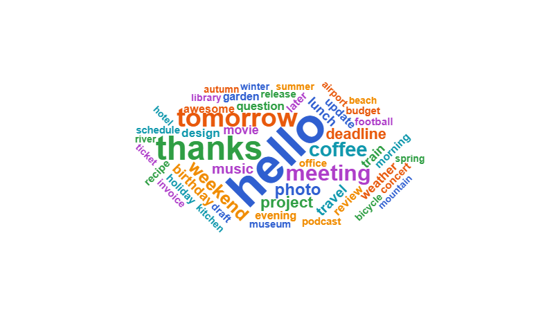
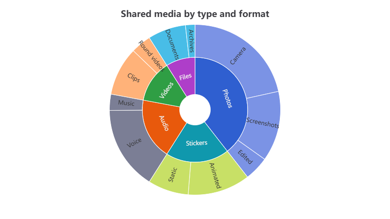
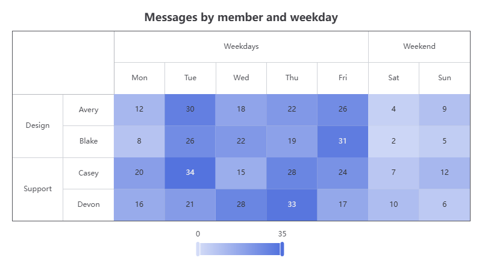
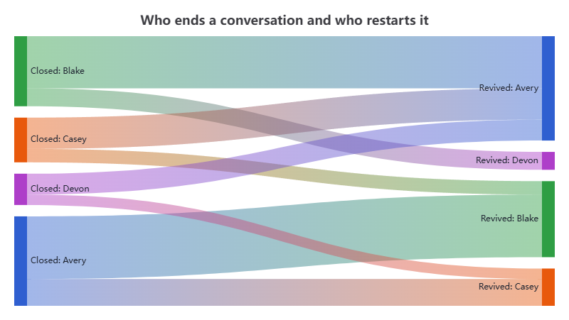
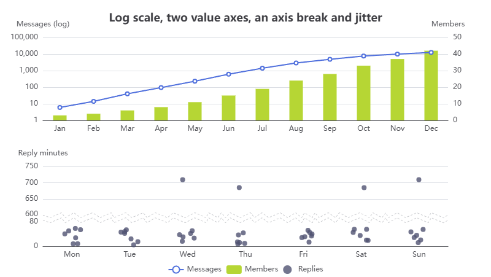
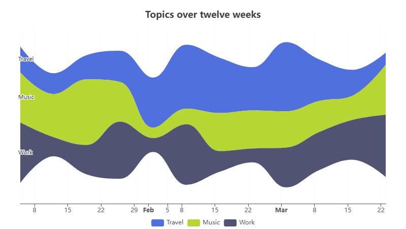

<div align="center">


# BlazorECharts

**Typed Blazor components and C# API for [Apache ECharts](https://echarts.apache.org/) 6.1.0**

Every documented option, event, action and chart method in C#, a word cloud built for ECharts 6,
and a release gate of more than 1,600 automated tests.

[](https://www.nuget.org/packages/Qyperion.BlazorECharts)
[](https://www.nuget.org/packages/Qyperion.BlazorECharts)
[](https://github.com/Qyperion/BlazorECharts/actions/workflows/verify.yml?query=branch%3Amain)
[](https://qyperion.github.io/BlazorECharts/)
[](LICENSE)

[](https://dotnet.microsoft.com/)
[](https://echarts.apache.org/)
[](docs/render-modes.md)
[](docs/compatibility/wasm-aot.md)

**[🎮 Live demo](https://qyperion.github.io/BlazorECharts/)** ·
**[🚀 Quick start](#-quick-start)** ·
**[📚 Documentation](#-documentation)** ·
**[📝 Changelog](CHANGELOG.md)**

</div>

## ✨ Highlights

- 🎯 **The whole ECharts 6.1.0 API, typed.** Every documented option, event, action and chart
  method that the 6.1.0 runtime implements has a typed C# member: all 23 series types, Matrix,
  Thumbnail, axis breaks, `setTheme`, `convertToLayout` and the rest. The models are generated from
  the pinned ECharts declarations and documentation, and unions, scalars and arrays keep the exact
  JSON shape that ECharts expects. The [scope gate](docs/maintaining/generator.md#scope-gate-npm-run-apicheck)
  lists the few things that stay untyped: documented options that ECharts 6.1.0 does not implement,
  values described inside callbacks, and a few global helpers that are called through
  `InvokeNativeAsync`.
- ☁️ **A word cloud that keeps up.** `Qyperion.BlazorECharts.WordCloud` ships
  [@qyperion/echarts-wordcloud](https://github.com/Qyperion/echarts-wordcloud) 3.0.0, a maintained
  fork of echarts-wordcloud for ECharts 6. Layouts stop on update, resize and disposal, 10,000 words
  no longer overflow the stack, `RandomSeed` repeats a layout, `Z`, `Zlevel` and `visualMap` opacity
  apply to the words, and exports wait for fonts, the mask and the finished layout. See
  [why the fork](docs/compatibility/echarts-6.1.0-wordcloud.md#why-the-fork).
- 🧩 **Every hosting model.** Interactive Server, Interactive WebAssembly, Interactive Auto and
  standalone WebAssembly, including trimmed and AOT-compiled WebAssembly.
- 📦 **No JavaScript setup.** The pinned ECharts module ships as a static web asset: no npm, CDN or
  `<script>` tag.
- 🔒 **Strict CSP friendly.** Formatters and other callbacks come from your own ES modules, so
  `script-src` needs neither `'unsafe-eval'` nor `'unsafe-inline'`. Inline JavaScript is an explicit
  opt-in. See [security](docs/security.md) for the complete Content Security Policy and for the
  ECharts features that insert HTML.
- 🖼️ **Exports you can trust.** PNG, JPEG and SVG exports wait until the chart, its images, fonts
  and the word cloud layout are stable.

## 🎮 Live demo

The [live demo](https://qyperion.github.io/BlazorECharts/) shows more than 45 examples as live
charts, from every series type to events, exports, maps and custom series. Open one to see it at
full size with its C# source, on the canvas or SVG renderer and in the light or dark theme. The demo
is the trimmed standalone WebAssembly app of
[`samples/BlazorECharts.Standalone`](samples/BlazorECharts.Standalone), deployed to GitHub Pages
from every release tag.

| | | |
|:---:|:---:|:---:|
| [](https://qyperion.github.io/BlazorECharts/examples/wordcloud)<br>**Word cloud** | [](https://qyperion.github.io/BlazorECharts/examples/sunburst-drilldown)<br>**Sunburst drill-down** | [](https://qyperion.github.io/BlazorECharts/examples/matrix)<br>**Matrix** |
| [](https://qyperion.github.io/BlazorECharts/examples/sankey-flow)<br>**Sankey** | [](https://qyperion.github.io/BlazorECharts/examples/axis-variants)<br>**Log axis and axis break** | [](https://qyperion.github.io/BlazorECharts/examples/theme-river)<br>**Theme river** |

## 📦 Packages

| Package | Version | Contents |
|---|---|---|
| [`Qyperion.BlazorECharts`](https://www.nuget.org/packages/Qyperion.BlazorECharts) | [](https://www.nuget.org/packages/Qyperion.BlazorECharts) | The `EChart` component, option models, events, actions, chart and runtime API, ECharts 6.1.0 |
| [`Qyperion.BlazorECharts.WordCloud`](https://www.nuget.org/packages/Qyperion.BlazorECharts.WordCloud) | [](https://www.nuget.org/packages/Qyperion.BlazorECharts.WordCloud) | The `wordCloud` series: @qyperion/echarts-wordcloud 3.0.0, a fork of echarts-wordcloud for ECharts 6 |

Both target `net10.0` and are released together with the same version. The package ids carry the
`Qyperion.` owner prefix; the assemblies, namespaces and `_content/BlazorECharts` asset paths keep
the name BlazorECharts. The id BlazorEcharts on nuget.org belongs to an unrelated library.

## 🚀 Quick start

```bash
dotnet add package Qyperion.BlazorECharts
```

Register the services in every interactive host, including the client project of a
WebAssembly or Auto app:

<!-- snippet: Package.Core.Program -->
```csharp
// Program.cs
using BlazorECharts.Runtime;

builder.Services.AddECharts();
```

Render a chart with a non-zero height in an interactive component:

<!-- snippet: Package.Core.Component -->
```razor
@page "/weekly-messages"
@rendermode InteractiveServer
@using BlazorECharts
@using BlazorECharts.Options
@using BlazorECharts.Values

<EChart Options="_options" Style="height:360px" />

@code {
    private readonly ChartOptions _options = new()
    {
        XAxis = new XAxisCategoryOption { Data = ["Mon", "Tue", "Wed"] },
        YAxis = new YAxisValueOption(),
        Series = new LineSeriesOption { Data = [12, 18, 9] },
    };
}
```

The chart draws only in an interactive render mode. `@rendermode InteractiveServer` suits an app
with per-page interactivity, such as the default `dotnet new blazor` template; leave it out when
the whole app is interactive, or use `InteractiveWebAssembly` or `InteractiveAuto`. With static
server rendering the page shows only the empty container. Each new `Options` is merged into the
chart as ECharts does; see [updates](docs/updates.md#automatic-and-explicit-updates).

### ☁️ Word cloud

```bash
dotnet add package Qyperion.BlazorECharts.WordCloud
```

<!-- snippet: Package.WordCloud.Program -->
```csharp
// Program.cs
using BlazorECharts.Runtime;
using BlazorECharts.WordCloud;

builder.Services.AddECharts().AddWordCloud();
```

<!-- snippet: Package.WordCloud.Options -->
```csharp
using BlazorECharts.Options;
using BlazorECharts.WordCloud;

var options = new ChartOptions
{
    Series = new WordCloudSeriesOption
    {
        Data = [new WordCloudDataItem { Name = "Blazor", Value = 40 }, new WordCloudDataItem { Name = "ECharts", Value = 32 }],
    },
};
```

Shapes, masks, rotation, fonts and colors from your own modules are described in
[extensions](docs/extensions.md#wordcloud).

## 🧪 Tested like a release

Every pull request and every release runs one release gate, `tools/Release/verify-local.ps1`, on a
clean Windows runner. A release is published only when every stage passes, and only the packages
that the gate verified are pushed to nuget.org.

| Layer | What the gate runs |
|---|---|
| 🧱 **.NET** | 670+ xUnit and bUnit tests: serialization, generated contracts, methods, events and the component lifecycle |
| ⚙️ **Generator and runtime** | 390+ Vitest tests of the binding generator and of the JavaScript interop |
| 🌐 **Browser** | 560+ Playwright tests against the real ECharts runtime in Interactive Server and WebAssembly, including every example of the demo on Canvas and SVG |
| 🧭 **Browser matrix** | Chrome, Edge and Firefox, plus Chromium and WebKit engine checks |
| 📦 **Packages** | Clean consumer apps restored from the packed `.nupkg` files: Server, WebAssembly, a class library, and trimmed and AOT-compiled WebAssembly |
| 🔐 **API** | Deterministic generation, the scope gate over the documented ECharts API and a frozen public API baseline for both assemblies |

See [testing](docs/maintaining/testing.md) and the [release checklist](docs/compatibility/release-checklist.md).

## 📚 Documentation

| Topic | |
|---|---|
| [Getting started](docs/getting-started.md) | Registration, namespaces, the first chart, init options |
| [Chart options](docs/options.md) | `ChartOptions`, unions, `OneOrMany<T>`, unset and unknown fields, dates and time zones, missing values, raw JSON |
| [Updates](docs/updates.md) | Automatic and explicit updates, merge modes, themes, recreation, `GetOptionAsync` |
| [Events and actions](docs/events.md) | Subscriptions, queries, throttling, payloads, dispatching actions, connected charts |
| [JavaScript functions](docs/functions.md) | Module and inline callbacks, custom series `renderItem` |
| [Chart and runtime API](docs/chart-api.md) | Instance methods, coordinate conversion, the page runtime |
| [Graphic and browser references](docs/graphic-and-references.md) | The graphic component, images, canvases, native objects and helpers |
| [Export](docs/export.md) | Stable layout, PNG, JPEG, SVG and connected exports |
| [Extensions](docs/extensions.md) | WordCloud, themes, locales, maps, custom series types, runtime providers |
| [Render modes](docs/render-modes.md) | Server, WebAssembly, Auto, standalone, prerendering, message size, reconnection |
| [Errors](docs/errors.md) | `OnError`, exceptions and error codes |
| [Security](docs/security.md) | HTML in tooltips, links, inline functions, Content Security Policy, modules from other origins |

Compatibility records: [hosting and browsers](docs/compatibility/hosting.md),
[trimming and AOT](docs/compatibility/wasm-aot.md),
[performance baseline](docs/compatibility/performance-baseline.md) and
[WordCloud](docs/compatibility/echarts-6.1.0-wordcloud.md).

## 🛠️ Maintaining

[Generator](docs/maintaining/generator.md), [testing](docs/maintaining/testing.md),
[release](docs/maintaining/release.md), [updating ECharts](docs/maintaining/update-echarts.md) and
[updating WordCloud](docs/maintaining/update-wordcloud.md). Report vulnerabilities as described in
[SECURITY.md](SECURITY.md).

## 📄 License

BlazorECharts is licensed under the [MIT License](LICENSE). Apache ECharts, ZRender, tslib,
@qyperion/echarts-wordcloud and wordcloud2.js keep their own licenses; see
[THIRD-PARTY-NOTICES.md](THIRD-PARTY-NOTICES.md).
